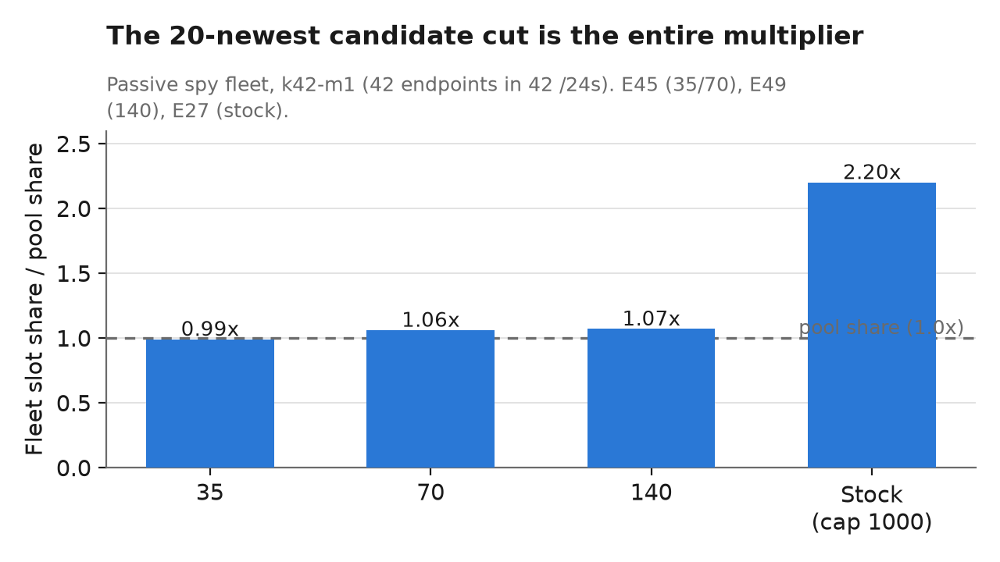
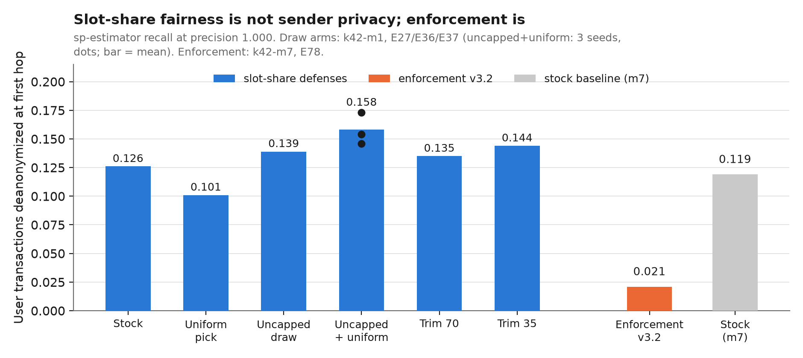
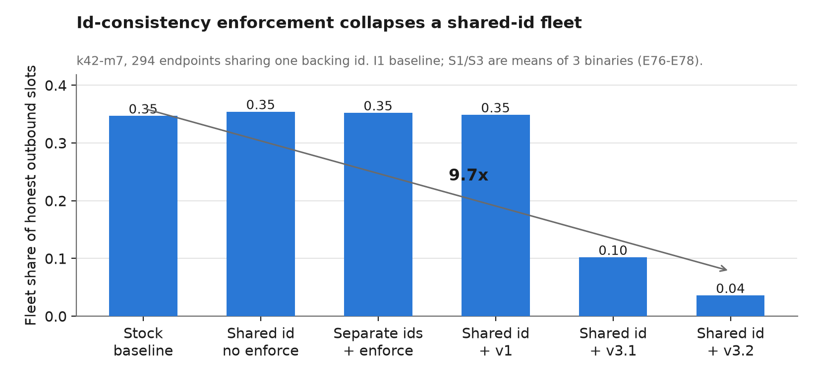
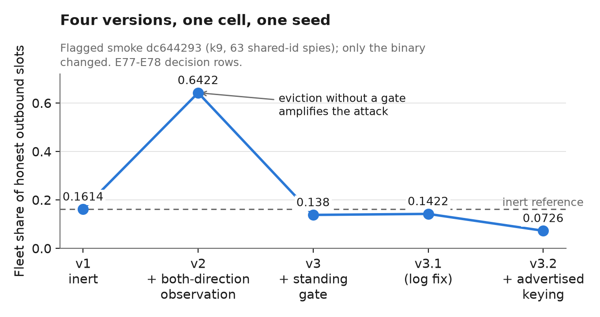
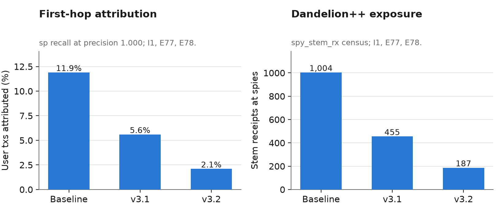

# Antiproxy study: findings summary (2026-11-11)

Supersedes `20261027_findings_summary.md` (Findings 1-8 stand; this adds 9-10 and
the enforcement chapter). Evidence: experiment journal entries E1-E79, predictions
P1-P77, 125 registered runs (`docs/SPY_EXPERIMENT_JOURNAL.md` is the source of
truth; every number below cites its entry). Paths relative to the repository root.
Figures live in `figures/` (regenerate: `venv/bin/python figures/make_figures.py`).

## The one-paragraph version

A spy fleet of cheap proxies multiplies its way into Monero peer lists because
stock monerod draws outbound candidates from the 20 *newest* white-list entries —
fresh gossip is cheap to fabricate. That gets the fleet 11-12% of user
transactions handed to it as the *first hop* of Dandelion++ spreading, at perfect
precision. Fixing the draw rule makes the fleet's share *fair* but not its
tracing power smaller — slot-share fairness is not sender privacy. The defense
that does cut tracing is observational id-consistency enforcement: a node that
sees one peer id claiming two addresses refuses the second a white-list slot,
collapsing a shared-id proxy fleet 9.7x with zero honest cost. Figure 3 tells
the whole story.

## What the study asks

How do spy fleets infiltrate Monero's peer lists and trace transaction origins
(Dandelion++ first-hop attribution), and which P2P-layer rules change that? The
lab: Shadow simulations of real `monerod` (v0.18.5.1 pinned, flag-gated patches
from `patches/series`), 300-reachable networks with 294-endpoint spy fleets
modeled on the real one (2026-09-23 crawl: 12,368 peer-id-mismatch endpoints,
1,941 IPs, dense /24s), pre-registered predictions scored blind against
measurements.

## Part I — the threat, measured

- **Passive exposure is a multiplier of the subnet share, and the 20-newest
  candidate cap is the multiplier** (Finding 1, E19-E49). Stock draws outbound
  candidates from the 20 newest /24-deduplicated white entries; a passive fleet
  reads 0.337 light share = 2.2x its pool share. Lifting the cap collapses the
  multiplier to 1.03x (E36/E37).

  
- **The real fleet's shape cannot buy more passive position** (Finding 9,
  E72-E75). On every layout axis the position pins at the /24-slot ceiling:
  7x more addresses per /24 moves nothing (I1 vs B1); /16 spread is dead (the
  fleet spans 9 /16s); budget scales sub-linearly. Stock white is already
  one-per-host; port multiplication buys gray-side pumping and gossip spread,
  not white slots.
- **Origin tracing at that position**: 11-12% of user transactions attributed
  straight-to-spy at precision 1.000 (sp estimator, hop-1), ~1,000 stem receipts
  per run. An *active* refresh adversary eclipses an untrimmed list entirely
  (0.908 light share, 96.7% attribution at precision 1.000; E58-E62).
- **Mainnet context** (Finding 2): the owner's node dumps show white pinned at
  the 1000-entry cap, every entry under 12.3h old — the flat region of the cap
  sweep. RTT scoring is dead as a defense (fleet median 220ms beats honest 472ms).
- X3/stemmable-inbound (tevador's MRL #160): stock starves hidden fleets; the
  variant gives bounded attribution-free hop-2+ channels and nothing buys hop 1
  (E63-E65).

## Part II — the defenses, measured

The ladder above is the study's sharpest result and its most cautionary one:
**every slot-share defense leaves first-hop deanonymization between 0.10 and
0.17 — the draw fix's best arm (uncapped + uniform, three seeds 0.146-0.173) is
*worse* than stock (0.126) at the estimator's perfect precision — while
id-consistency enforcement takes it to 0.021, and enforcement *plus* the draw
fix takes it to 0.000 (E79: 0 of 984 user transactions attributed).** Fair
share of outbound slots is a fairness property, not a privacy property:
spreading the fleet's occupancy across more honest dials spreads the *first
hops* across more spies. And the two defenses compose with the trap inverted
(E79, run 125): under enforcement the fleet exists as one standing address per
observing node — the stock recency draw re-surfaces that address every churn
cycle, the uniform draw gives it ~1/340 of candidate draws — so the rule that
alone *raised* tracing, stacked on enforcement, starves the fleet's last
address instead (light 0.3467 → 0.006, 58x; receipts 1,004 → 26; refusals 312
all-spy/zero-honest).

1. **The candidate-draw fix** (one rule, ready for upstream): draw candidates
   from the whole subnet-deduplicated white list instead of the 20 newest —
   the 2.2x passive multiplier collapses to 1.03x, and the active adversary's
   0.908 falls to 0.599 (uniform draw) or 0.0248 (with a 70-entry trimmed list).
   Lab evidence E19-E49; the oldest and cheapest result in the study. It fixes
   the fleet's *share* of honest outbound slots; it does not by itself reduce
   what the fleet learns (see the ladder above).
2. **Per-host gray-list cap** (R8 patch, `--sim-peerlist-ports-per-host`):
   provably inert without same-IP endpoints (M2 null-validation, E73) — the
   lab's m-daemons get distinct IPs, so the port-front model needs the same-IP
   generator feature before this rule's real test.
3. **Observational id-consistency enforcement** (R9 patch v3.2,
   `--sim-enforce-id-consistency`, the new chapter E76-E78):

   A node records, per its own connections (both directions), which peer id it
   directly observed at which advertised address. An id observed at ≥2 addresses
   within a grace window loses white-list *standing* at all but the freshest
   address: existing entries are evicted AND re-insertion is refused at every
   white entry path while the violation is live. A shared-id proxy fleet — the
   real crawl's fingerprint — is demoted to one standing address per observing
   node.

   **Measured at k42-m7 (294 shared-id endpoints, 19h steady state, E78):**
   light share 0.3467 → **0.0359 (9.7x collapse)**; hop-1 attribution 11.9% →
   **2.1% of user transactions at precision 1.000**; refusals 308, all spy
   addresses, **zero honest**; honest D++ throughput unchanged (stem_txs 1,048
   vs 1,004 baseline). The evasion bound holds by construction: a per-endpoint-id
   fleet pays nothing (0.3494 vs baseline 0.3467, refusals exactly 0) — priced
   instead by escalation layers beyond this rule (signed id bindings,
   per-identity work). Flag-off is a structural null: three binaries read the
   null within noise (0.3519-0.3586), refusals exactly 0.

   

   

   

   **The composition closes the ladder (E79, P77, run 125):** the same cell
   with the candidate-draw fix on every honest daemon takes light share to
   **0.006** (58x below baseline; enforcement-only 0.0359), stem receipts to
   **26**, hop-1 user transactions to **0**, and sp recall to **0.000 — 0 of
   984** — still 312 refusals, all spy, zero honest. Every filed band missed
   below: the fairness trap inverts under enforcement (see the ladder).

   **Polarity caveat (11-11, from a colleague's challenge):** peer ids are
   self-declared and spoofable, and the raw crawl re-read shows the real fleet
   spoofs them — 12,368 flagged endpoints carry **12,368 distinct handshake
   ids** but only **40 distinct PING ids** (the backends', disjoint from the
   handshake set; unflagged nodes share handshake ids at 8.5%). v3.2 observes
   handshake messages, so E78/E79 are the shared-handshake-id polarity (fronts
   forwarding the backend's handshakes); the crawl's exact polarity needs the
   evidence map fed from PING responses as well — the designed v3.3 amendment,
   one observation site on a path the patch already touches. The all-unique-id
   bound (per-endpoint ids in every message) stays priced out of scope.

   **The design lessons cost four patch versions, each caught by a
   pre-registered check:** v1 observed ids only on inbound handshakes and was
   structurally blind to relay-dialed fleets (E76: 1,022/1,022 receipts
   relay-dialed, no effect); v2 added client-side observation but evicted
   without gating re-insertion — a freshness treadmill that *amplified* the
   fleet 4x (smoke: 0.6422 vs 0.1614 inert); v3 gated insertion but keyed
   observations by ephemeral source port, manufacturing 40,795 honest
   false-positives (E77's no-collateral check); v3.2 keys by the advertised
   address and lands at the theoretical floor. General rule: **demotion must
   pair eviction with a standing gate, and observation must cover both
   connection directions.**

## What transfers, and what doesn't

Measured at 42-/24 fleets on 300-reachable simulated networks, one seed per arm
(the E78 trio's second seeds are queued work); mainnet's lists sit in the flat
cap region (Finding 2), which is the regime the lab measures. The enforcement
rule needs no wire changes and no new messages — it is a local policy on
directly observed evidence — but its adoption is a monerod decision, and its
grace window (24h here) trades honest dynamic-IP moves against fleet demotion
speed. The crawl fingerprint (shared ids across a port-multiplied front) is the
rule's target; sophisticated fleets with per-endpoint ids are out of scope by
design and are the escalation layers' problem.

## Reading order

`STATUS.md` (this folder) for current state; the journal for any number's
provenance; `docs/spy_journal/runs/` for per-run artifacts (estimator reports,
receipts censuses, calibration); `analysis/spy/` for the tools;
`patches/series` + `studies/antiproxy/patches/` for the flag-gated monerod
patches (R8 per-host cap, R9 id-consistency v3.2). The narrative manuscript for
a human reader is `20261111_manuscript.md`; `figures/make_figures.py` regenerates
every figure from journal-cited values.
