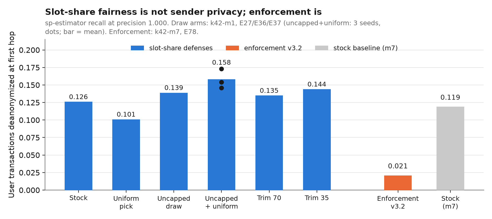
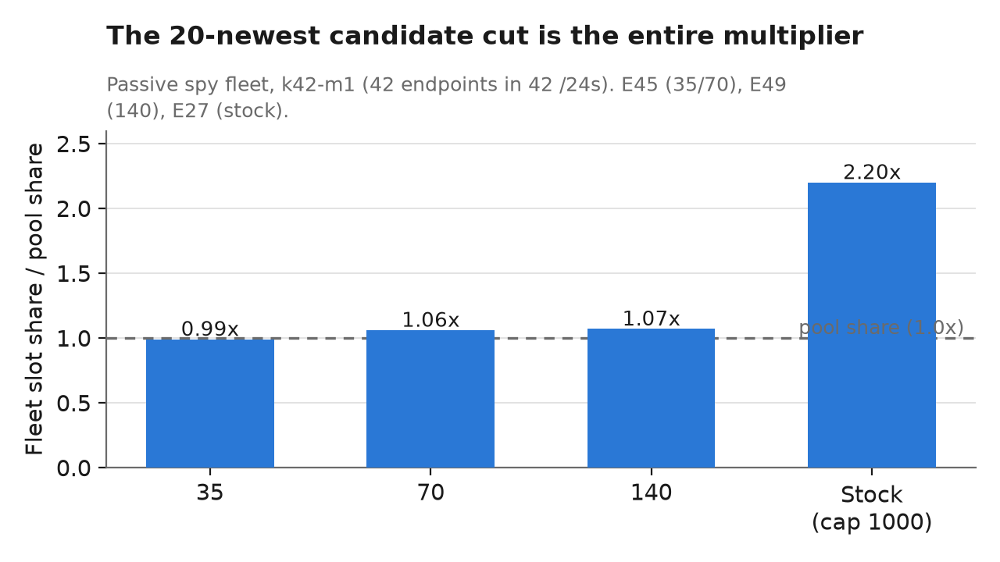
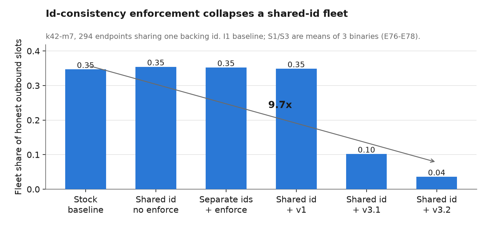
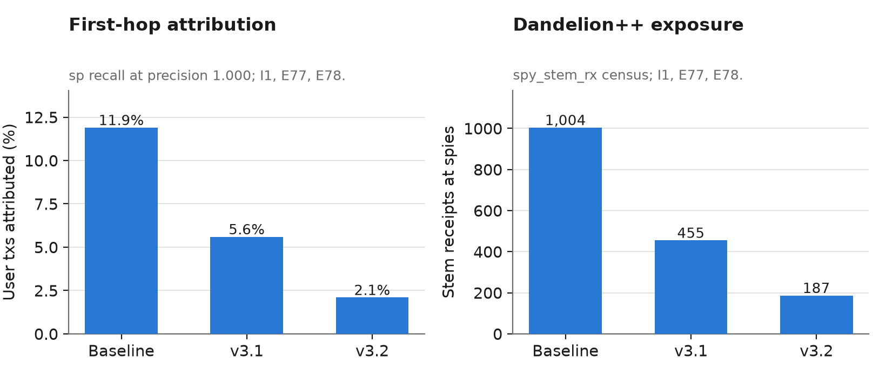
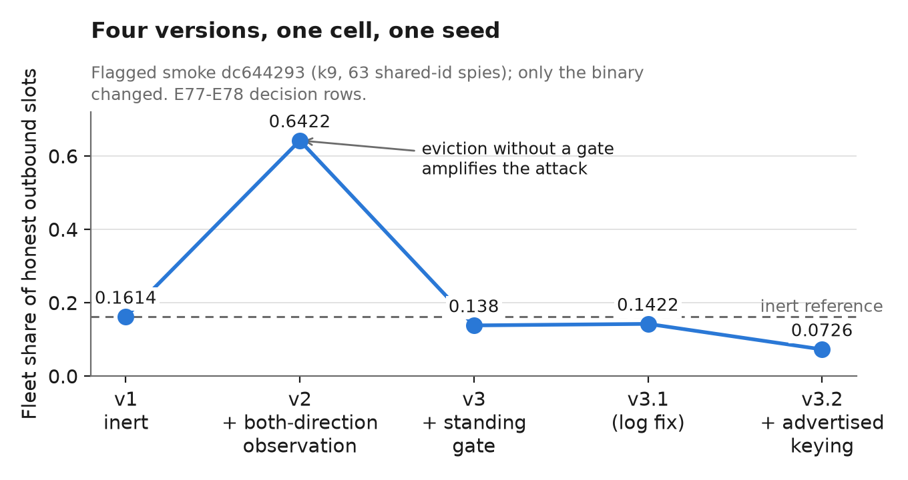

# One id, many addresses: how proxy fleets ride Monero's peer lists, and the local rule that stops them

A narrative manuscript for the antiproxy study, 2026-11-11. Everything here is
measured: each number cites an entry (En) or filing (Pn) in
`SPY_EXPERIMENT_JOURNAL.md`, where every prediction was filed before its
experiment ran and scored blind against the outcome afterwards — 125 registered
runs so far. The technical summary with full citations is
`20261111_findings_summary.md`; this document is the story for a reader who
wants to understand it without reading the journal.

## The short version

Someone wanting to learn who sends Monero transactions does not need to break
cryptography. It is enough to run many cheap proxies — a few real `monerod`
backends behind many forwarded addresses — and let the network's own peer
selection carry honest nodes' traffic to them. A September 2026 crawl of the
live network found 12,368 of 18,026 reachable endpoints carrying the
fingerprint of exactly that design: fresh handshake identities minted per
address, but only 40 distinct ids on the ping path — the backends leaking
through their fronts (E3, re-read 11-11). In our simulations such a fleet,
entirely passive, occupies 2.2 times its
fair share of honest nodes' outbound connections and receives 11–12% of user
transactions *as the first hop* — the hop whose sender is, by construction, the
transaction's origin. The attribution is perfect-precision: every transaction
the fleet attributes, it attributes correctly.

Two defenses follow from the measurements, and they are not the two one would
guess. Fixing the rule that lets the fleet multiply its share — the obvious,
one-line fix, ready for upstream — makes the fleet's share *fair* but leaves
its tracing power untouched, or slightly worse. The defense that cuts tracing
is a local, observational rule: a node that has *directly seen* one peer id
presenting two different addresses simply refuses the second address a place
in its white list, for as long as the contradiction stands. Measured in the
lab, that rule collapses a shared-id fleet 9.7-fold, takes attribution to 2.1%
— and **zero** when stacked with the draw fix (E79).

**But there is a hard bound on that second defense, and it must be stated
before anything else is believed: peer ids are self-declared and spoofable,
and the deployed fleet already spoofs them.** An observational id rule can
only catch what a front fails to rewrite consistently; a front that mints a
fresh, consistent id per address — in every message type — is indistinguishable
from that many honest nodes at the p2p layer, and no observation defeats it.
The measurements below are against *leaking* designs (the lab's all-shared
polarity; the deployed fleet leaks on its ping path). They are real results
about the fleets that exist today, and they are not a standalone answer to a
careful fleet. The ladder that ends the race is priced identity — tying the id
to something unforgeable, e.g. an on-chain anchored key (designed below, not
measured).

## Background: the two lists and the first hop

A Monero daemon keeps two lists of peers. The **white list** holds up to 1000
reachable peers it has actually talked to; the **gray list** holds peers it has
merely heard about. When the daemon needs a new outbound connection, it picks
*candidates* from the white list — and stock `monerod` picks them from the 20
**newest** entries by last contact, preferring whichever /24 subnet the least
recently-used entry came from. Freshness, in other words, is the currency of
connection slots.

Transaction propagation uses Dandelion++: a wallet's transaction first goes to
one node (the **first hop**), which holds it and forwards it through a random
*stem* of one or more intermediaries before it fluffs out to the network. The
privacy of the whole construction rests on the first hop being honest: the
first node in the stem necessarily learns the sender's IP address. A fleet
that occupies first-hop slots doesn't need to break anything — the origins
arrive on their own.

This is why "share of outbound slots" and "fraction of transactions
deanonymized" are the two numbers this study tracks. The first is the fleet's
*position*; the second is what the position *buys*.

## The threat, measured

The lab is a discrete-event network simulator (Shadow) running real, unmodified
`monerod` v0.18.5.1 binaries — patched only with flag-gated instrumentation
that is off by default and provably inert (E78's null arm: three successive
binaries, flag off, read the same slot share within noise). A typical
experiment is a 300-reachable-node network with a fleet modeled on the crawl:
294 spy endpoints spread over 42 /24 subnets, each subnet's addresses behind
the same shared backing id where the arm calls for it. Sender traffic mimics
mainnet rates. Fleet-side estimation uses only what a real spy could log: which
addresses received stem transactions, and when.

Three facts define the threat (Part I of the study):

**The 20-newest cut is the multiplier.** A passive fleet that does nothing but
accept connections and gossip ends up occupying 0.337 of honest outbound slots
— 2.2x its share of the address pool (E27). The mechanism is the candidate
rule above: a fleet with many addresses in dense /24s refreshes its own
entries constantly, so the "newest 20" is systematically fleet-heavy. Lift the
cap so candidates come from the whole deduplicated white list and the
multiplier collapses to 1.03x (E36/E37) — the fleet gets exactly its fair
share of slots and not one more.

**The fleet's shape cannot buy more position.** More addresses per /24, /16
spreading, bigger budgets: none of it moves the passive needle, because the
per-/24 dedup means a fleet gets one white slot per prefix per node — stock
white lists are already one-entry-per-host (E72–E75). The port-multiplication
the real crawl shows buys gray-side gossip spread, not white-list standing.

**What the position buys is origin identity.** At that steady state the fleet
receives ~1,000 stem transactions per run and attributes 11.9% of user
transactions to their true origin at precision 1.000 (I1 baseline of the
enforcement trio). An *active* adversary — one that refreshes its own entries
to stay permanently newest — eclipses an untrimmed list entirely: 0.908 slot
share and 96.7% attribution (E58–E62). Mainnet context makes this concrete:
the owner's node dumps show white lists pinned at the 1000 cap with every
entry under 12.3 hours old — the flat, saturated regime right where these
mechanisms operate (Finding 2).

## The fairness trap

So the obvious defense is the one-line draw fix. It is cheap, it is fair, and
it works exactly as designed: share drops to 1.03x. One would expect tracing
to fall with it.

It doesn't. Across three seeds, networks running the draw fix — candidates
uncapped, selection uniform — show *higher* first-hop attribution than stock:
recall 0.146–0.173 against stock's 0.126, all at precision 1.000 (E36/E38/E41;
the uniform-pick-only arm E35 reads 0.101). Trimming the white list to
mainnet-like sizes (70 or 35 entries) lands back in the same 0.13–0.14 band
(E45, E50). The blue bars in the ladder figure are all the same height, and
the best "fairness" arm is the tallest of them.

The mechanism is simple once stated: slot-share defenses spread the fleet's
occupancy across more honest nodes, but every slot they keep is still a first
hop, and a first hop is a first hop. Spreading the fleet's share *fairly*
spreads the *origins* fairly — across more spies. **Fairness is a property of
the honest nodes' connection budgets; privacy is a property of who holds the
first-hop slots. The draw fix buys the first and not the second.**

This is the study's most cautionary result, and the reason the orange bar
matters.

## The defense that works: observe ids, gate addresses

The crawl's fingerprint is subtler than "one id everywhere," and the
distinction decides what a defense must observe. Peer ids are self-declared,
unauthenticated 64-bit values — nothing in the protocol binds an id to its
presenter, so a protocol-aware front can mint a fresh one per address, and the
real fleet does. Measured on the raw crawl: the 12,368 flagged endpoints
present **12,368 distinct handshake ids** (one per address) but only **40
distinct PING ids** — per-address handshake identities, with the backing
daemons' ids leaking through the PING support path (the two id sets are
disjoint; unflagged nodes share handshake ids at only 8.5%). The structural
weakness is not that ids cannot be spoofed — they can — but that the
cheap-front design leaks the backends' ids somewhere, and the ping path is
where it leaks today. A defense must observe what the fronts fail to rewrite
consistently, per message type.

The rule (patch R9 v3.2, `--sim-enforce-id-consistency`, off by default): a
node records, per its directly observed connections in *both* directions,
which peer id it saw at which advertised address. If one id is observed at two
or more addresses within a grace window (24h in the lab), every address but
the most recently observed one loses **standing**: existing white entries are
evicted, and every path that could re-insert them refuses while the
contradiction is live. The fleet is demoted to one standing address per
observing node. No wire format changes, no new messages, no coordination —
it is a local policy on local evidence. **As built, v3.2 observes ids on
handshake messages** — so the measurement below is the shared-handshake-id
polarity (a fleet whose fronts forward the backing daemon's handshakes, the
lab's `_sid` model). The crawl's exact polarity above — unique handshake ids,
shared ping ids — needs the same map fed from PING responses as well: a
designed amendment (v3.3), one more observation site on a path the patch
already touches.

**The spoofability bound, stated plainly.** Every measured number in this
section is a result about a fleet that *leaks* ids. The lab's fleet shared
them everywhere; the deployed fleet leaks its backends on the ping path.
(The threat measurements of Part I are untouched by this bound — none of them
read a peer id; the multiplier, the fairness trap, and the trims are
candidate-draw mechanics.) Against a front that rewrites consistently — one
fresh id per address in every message field — the observational rule is
structurally inert, and no extension
of it (more message types, more observation sites) changes that: 300 addresses
with 300 consistent ids are 300 nodes, as far as any observer can tell. The
fairness-trap result says that fleet traces at least 0.10-0.17 of user
transactions with no defense but the draw rules. So the honest summary of the
defense line is a cost ladder, and only the first rung is measured:

1. **Free local observation** (v3.2, measured): defeats lazy and leaking
   designs. The deployed fleet leaks today — measured on the crawl — so this
   rung is not academic; it costs honest nodes nothing and needs no wire
   change.
2. **Wider observation** (v3.3, designed): feeding the evidence map from PING
   responses defeats the deployed fleet's exact polarity — its ~40 backend ids
   are shared across ~300 fronts each, a denser contradiction than any lab arm
   has tested. Still observational, still evadible by consistent rewriting.
3. **Priced identity** (designed below, not measured): the only rung a careful
   fleet cannot rewrite its way past, because there is nothing to rewrite —
   the binding is to cost, not to observation.

**Measured** (k42-m7, 294 shared-id endpoints, 19-hour steady state, E78):

- Slot share: 0.3467 → **0.0359** — a 9.7x collapse, at or below the
  theoretical one-slot-per-prefix floor.
- Origin attribution: 11.9% → **2.1%** of user transactions, still at
  precision 1.000; Dandelion++ stem exposure falls from 1,004 receipts to 187.
- Cost: **zero honest refusals** — all 308 refusals land on spy addresses —
  and honest stem throughput unchanged (1,048 vs 1,004 baseline transactions).
- The bound: a fleet that mints a fresh id per endpoint pays *exactly nothing*
  (0.3494 vs 0.3467 baseline, refusals exactly 0, E78's bound arm). The rule
  prices the cheap design, and the priced alternative — per-identity keys or
  signed id bindings — is a different, harder game.
- The null: with the flag off, three successive binaries read the same slot
  share within noise. The instrumentation is inert when off, structurally.

## Four versions, one lesson

The rule looks obvious in retrospect. It took four versions to get right, and
each failure was caught by a pre-registered check, not by luck:

- **v1** recorded ids only on *inbound* handshakes — and the fleet, dialed
  outbound by honest nodes, never triggered it. 1,022 of 1,022 receipts were
  relay-dialed; the maps stayed empty (E76). *Observation must cover both
  connection directions.*
- **v2** added client-side observation but only *evicted* — evicted entries
  were immediately re-inserted by the next handshake, a freshness treadmill
  that briefly let the fleet *quadruple* its share (smoke cell: 0.6422 against
  0.1614 inert). *Demotion without a standing gate is worse than nothing.*
- **v3** gated re-insertion but keyed observations by the connection's
  ephemeral source port — so honest peers behind NAT rebinding read as
  id-contradictions, manufacturing 40,795 honest refusals (E77's no-collateral
  check caught it). *Key by the advertised address, the identity the network
  actually uses.*
- **v3.2** keys by advertised address and lands at the floor.

Generalized: **a demotion rule must pair eviction with a standing gate, and an
observation rule must see what it claims to observe, in both directions.**
Both lessons generalize well past Monero.

## What transfers, and what doesn't

- The mechanisms — the 20-newest candidate cut, per-/24 dedup, one-slot-per-
  prefix, the shared-id fingerprint — are properties of the monerod code and
  the protocol, not of our lab, and the mainnet dumps sit in the regime the
  lab measures. The transfer caveat that remains is scale (300-reachable
  networks; single seed per arm for the newest results, with second seeds
  queued).
- The enforcement rule needs adoption by monerod to matter on mainnet; its
  grace window trades honest dynamic-IP moves against demotion speed, and
  that trade is a policy decision, not a measurement.
- Peer ids are spoofable, and the measured fleet already spoofs them — the
  rule's power comes from what the fronts *fail* to rewrite, not from
  unforgeable ids. As built (v3.2, handshake observation) it collapses fleets
  that forward the backing daemon's handshakes; the crawl's exact polarity
  (unique handshake ids, 40 shared ping ids) needs the evidence map fed from
  PING responses too — a small, designed amendment (v3.3) on a code path the
  patch already touches. A fleet that mints unique ids in *every* message type
  reads as independent nodes and is priced elsewhere (see "Tying ids to
  proof", next section).

## Tying ids to proof: the rung a careful fleet cannot rewrite

The question the spoofability bound forces: can a peer id be bound to
something a front cannot cheaply multiply? The p2p layer itself offers no
such thing — a proxy can relay any chain evidence a backend produces (our own
variant-P front does exactly this), so "prove you follow the chain" separates
fronts from nothing. The binding has to be to *cost*, and the network already
has two working examples of pricing identity: the /24 slot (one standing
entry per prefix — the entire passive surface pins at it) and, in the other
direction, the fleet's own economics (many cheap fronts, few backends).

The concrete design — sketched here, **not measured** in this study:

- A node generates a keypair and anchors its public key on-chain, e.g. by a
  burned output carrying `H(pubkey)`. The anchor's age and amount are the
  identity's price.
- The handshake (or ping) carries `sig = Sign_privkey(peer_id, advertised
  address, current height)`. An observer verifies the signature against the
  anchored key, and requires anchors past some age/amount threshold.
- Consequences: one key per address means one burn per front — at the
  measured fleet's scale, 12,368 anchors. One key across addresses is *worse*
  for the fleet than today's shared id: every signature is cryptographic
  proof of common control, indexable by anyone (today's shared ping ids took
  a crawl to find; anchored keys confess on every connection).
- Honest dynamic-IP nodes keep their key across address changes — which also
  retires the grace-window tension the observational rule carries (v3.2's 24h
  window trades honest moves against demotion speed; an anchored key moves
  with the node).
- The offline variant, if a wire change is unacceptable: per-identity proof
  of work on the id (hashcash-style), weaker because it prices time rather
  than stake and can be farmed.
- The cost, stated honestly: a wire change and an adoption debate. A
  permissionless network resists per-node costs on principle — every honest
  node pays, and the debate is legitimate. That is why this is the top rung
  and not the first move: rungs 1-2 are free, local, and defeasible; rung 3
  is expensive, cooperative, and not.
- The composition question is closed (E79, run 125): the draw fix stacked on
  enforcement takes the fleet's tracing to **zero** — 0 of 984 user
  transactions attributed, light share 0.006 (58x below baseline), stem
  receipts 1,004 → 26, refusals still all-spy/zero-honest. The fairness trap
  inverts: under enforcement the fleet survives as one standing address per
  observing node, and the uniform draw that alone *spread* first-hops to more
  spies now spreads honest dials away from that last address (~1/340 of
  candidate draws instead of riding the 20-newest window). The two defenses
  are complements — each fixes what the other cannot.

## How to read the evidence

Everything is reproducible from this repository: the journal
(`SPY_EXPERIMENT_JOURNAL.md`) with its 125 registered runs and pre-registered
predictions; the flag-gated patches (`studies/antiproxy/patches/`, applied via
`patches/series`); the generators and analysis tools; and per-run artifacts
(`docs/spy_journal/runs/`). Figures regenerate from journal-cited values with
`figures/make_figures.py`. The one thing not in the repository is raw mainnet
data — crawl outputs and node dumps stay local by policy; only derived,
aggregate numbers appear here.
